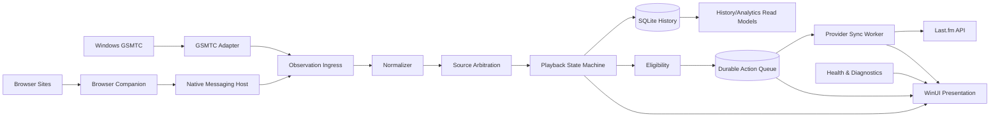

# System Architecture

> **Project:** Scrobblix  
> **Owner:** Rahul Muraleedharan (`frpboy`)  
> **Status:** Documentation baseline  
> **Last updated:** 2026-08-01

## Architectural style

Scrobblix uses a modular monolith with Clean Architecture boundaries and event-driven background services. A monorepo contains the Windows UI, native host, browser extension, tests, documentation, packaging, and build tooling.

## Layers

### Domain

Pure business concepts: observation, media identity, canonical play, state machine, played-time accumulator, eligibility, duplicate key, queue action model, reason codes, provider outcome classification. No WinRT, HTTP, SQLite, UI, or logging implementation references.

### Application

Use cases and orchestration: ingest observation, reconcile source, connect provider, queue scrobble, process due actions, query history, export, backup, run health checks. Depends on domain and interfaces.

### Infrastructure

GSMTC, SQLite, Last.fm HTTP/signing, Credential Locker, Native Messaging transport, notifications, file system, network monitor, updater, logging, clock abstractions.

### Presentation

WinUI views/view-models, navigation, commands, formatting, accessible content, and user interaction. It consumes application services/read models and never performs provider/database logic directly.

### Browser Companion

Separate TypeScript application with content/site adapters, service worker, permission manager, protocol client, fixtures, and browser packaging.

## Process model

Recommended initial processes:

1. `Scrobblix.exe` — UI plus hosted background services; single instance.
2. `Scrobblix.NativeHost.exe` — short-lived/connected Native Messaging host launched by browsers; forwards validated observations through a private authenticated IPC channel to the main process or hosts the shared application ingress safely.

The exact main-process IPC is an implementation detail behind an interface. Named pipes with per-user ACL and handshake are recommended; do not open a general localhost HTTP/WebSocket endpoint.

## Data model strategy

SQLite is the authoritative store for observations retained by policy, canonical plays, state transitions, queue actions/attempts, settings metadata, and cached analytics. Credential Locker stores provider session secrets. Artwork is a bounded file cache referenced by content hash.

## Provider strategy

`IScrobbleProvider` isolates Last.fm. Provider-specific parameters and response codes remain in infrastructure, mapped into stable domain outcomes. This prevents provider quirks from leaking throughout UI and queue logic.

## Design constraints

- All time-sensitive logic uses an injected wall clock plus monotonic time source.
- All external inputs are validated and size-bounded.
- Queue leasing prevents concurrent duplicate processing.
- UI reads immutable snapshots/read models rather than owning mutable engine state.
- Significant state transitions are persisted and observable.
