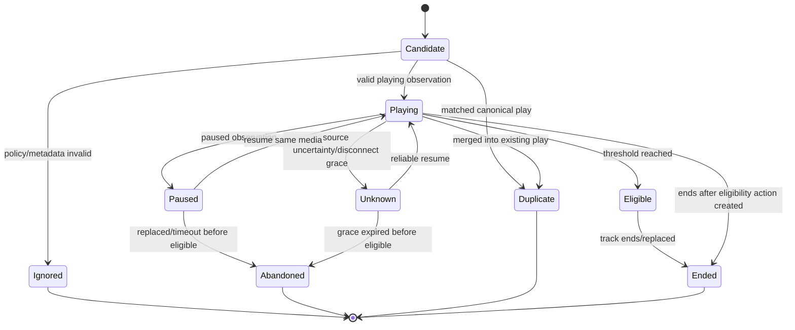
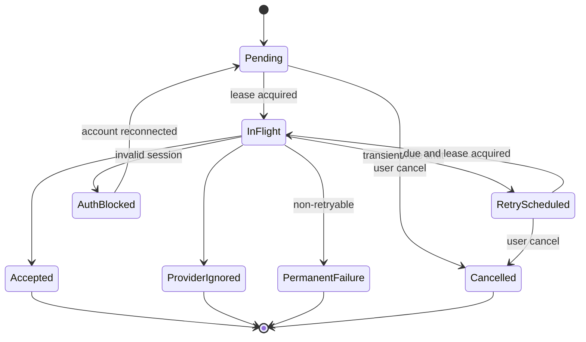

# State Machines

> **Project:** Scrobblix  
> **Owner:** Rahul Muraleedharan (`frpboy`)  
> **Status:** Documentation baseline  
> **Last updated:** 2026-08-01

## Play session

Eligibility is a milestone orthogonal to playback state in implementation; the diagram simplifies it. A play can remain playing after eligibility.

## Queue action

## Provider health

`Unknown → Checking → Healthy | Degraded | Offline | AuthenticationRequired | Suspended`. Health is not inferred solely from one request; transitions use explicit evidence and cooldowns.

## Extension connection

`NotInstalled → InstalledNoHost → HostRegistered → Connecting → Connected → VersionMismatch/PermissionRequired/Disconnected`. Repair actions correspond to each state.

## Persistence requirement

State transitions that affect eligibility, queue, provider outcome, user-visible reason, or recovery must be persisted atomically before publication to UI.
